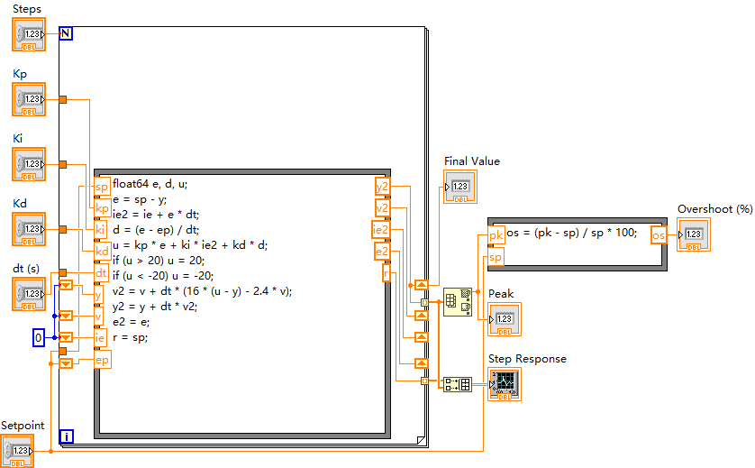
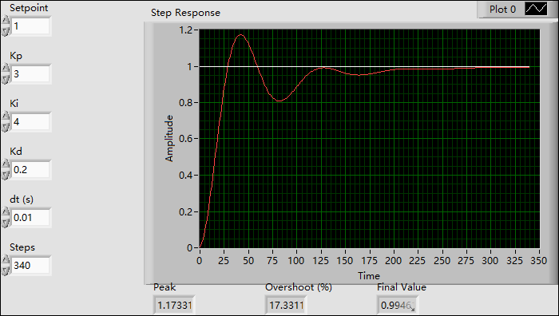
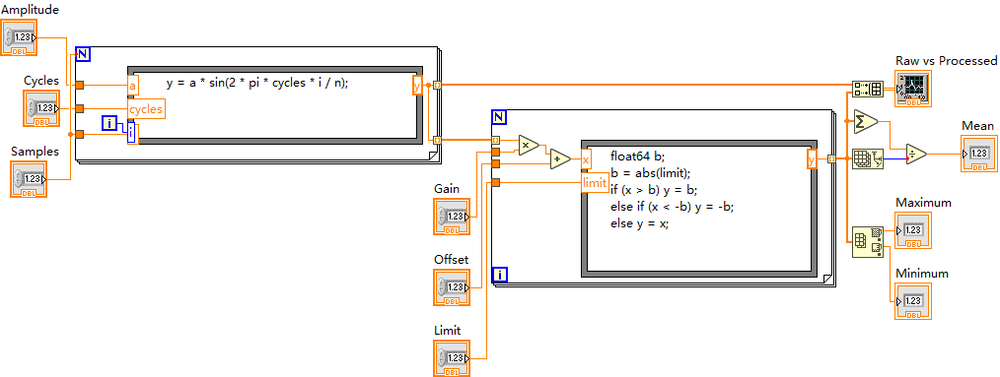
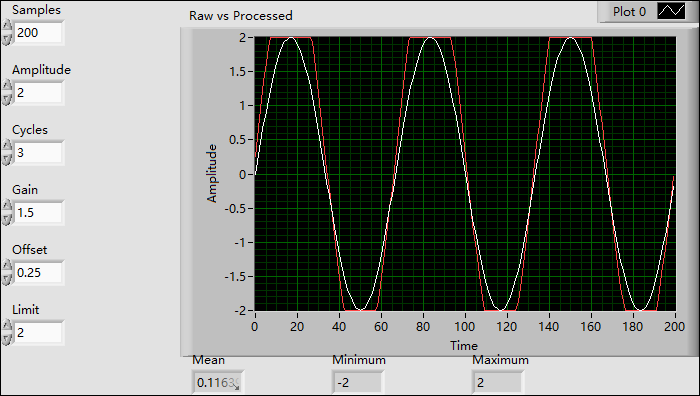

# LabVIEW Native MCP

让 AI 通过 [MCP](https://modelcontextprotocol.io) 直接操作 LabVIEW：在真实的前面板和程序框图上放控件、建循环、写公式、连线、整理、保存、运行，并把结果截图返回给 AI 检查。

底层是 LabVIEW 自带的 VI Scripting（经 COM 调用），不注入 DLL，也不模拟鼠标。

<p align="center">
  
  
</p>
<p align="center"><sub>PID 闭环：从空 VI 开始全部由 MCP 搭建，4 个移位寄存器、27 根连线，运行结果与 Python 仿真逐点一致。</sub></p>

> **项目状态：公开测试中。** 已验收 **LabVIEW 2021 x64（英文版）** 和 **LabVIEW 2018 x86（中文版）**：两个版本都跑通了全部测试和两个示例，也可以同时各开一个服务器。其他版本、位数或语言还没有验证，欢迎联系合作适配。

## 安装

**前置条件**：Windows x64；已授权的 LabVIEW 2021 或 2018 开发版（只有 Runtime Engine 不行），32 位或 64 位都可以；Python 3.12 x64。LabVIEW 需要开启 VI Scripting，并在 `LabVIEW.ini` 里有 `SuperSecretPrivateSpecialStuff=True`（安装指南会让 AI 检查，修改前先征得你同意）。不需要 npm。

**最省事的方式：让你的 AI 来装。** 把下面这段话发给 Claude Code / Codex / Cursor 等能执行命令的 AI：

```text
请按照 https://github.com/chinayuren2022-2025/labview-native-mcp/blob/main/docs/INSTALL_FOR_AI.md
的步骤，在这台 Windows 电脑上安装 LabVIEW Native MCP，并把它注册到你自己（当前这个 AI 客户端）的 MCP 配置里。
每一步都检查输出，遇到前置条件不满足就停下来告诉我。
```

**手动安装**：

```powershell
git clone https://github.com/chinayuren2022-2025/labview-native-mcp.git
powershell -NoProfile -ExecutionPolicy Bypass -File .\labview-native-mcp\install.ps1 -LabVIEWVersion 2021
```

安装器会创建独立的 `.venv`（位于 `%LOCALAPPDATA%\LabVIEWNativeMCP`），真的连上 LabVIEW 建一个测试 VI，看到 `INSTALL_PROBE_OK` 就说明装好了。它同时生成 `mcp-config.json`，里面是一个名为 `labview-native-2021`（或 `-2018`）的服务器条目，合并进你的 MCP 客户端配置即可，各客户端的写法见 [docs/INSTALL_FOR_AI.md](docs/INSTALL_FOR_AI.md)。

两个版本都要用时，把安装器按 `-LabVIEWVersion 2021` 和 `-LabVIEWVersion 2018` 各运行一次，再分别注册。同时运行的两个版本必须一个 32 位、一个 64 位，因为 Windows 的 COM 注册是按位数区分的。

## 示例

两个示例都从空 VI 开始，全部通过 MCP 调用完成：搭建、整理、保存、运行，再和 Python 的计算结果逐点比对。

```powershell
$env:LABVIEW_VERSION = '2021'     # 或 '2018'；装了多个版本时必须指定
python examples\pid_loop.py       # PID 闭环 + 二阶对象，阶跃响应曲线
python examples\signal_chain.py   # 正弦生成 → 增益/偏置 → 限幅 → 统计
```

<p align="center">
  
  
</p>

用安装目录里的 Python 运行：`%LOCALAPPDATA%\LabVIEWNativeMCP\.venv\Scripts\python.exe`。输出在 `examples/output/`。

## 工具

| 工具 | 作用 |
|---|---|
| `version_info` | 当前连接的 LabVIEW 版本、位数和安装目录 |
| `search_styles` | 按名字搜索 LabVIEW 原生对象（共 1117 种），支持模糊匹配 |
| `new_vi` / `open_vi` | 新建 VI（不覆盖已有文件）/ 打开 VI；`reload=True` 丢弃未保存的修改，重新从磁盘读取 |
| `add_object` | 放置控件、函数、结构，或按路径放置 SubVI |
| `inspect_node` | 列出节点的端子；循环会标出 `i` / `N` / `condition`，常量标出 `value` |
| `add_shift_register` | 给循环加移位寄存器，返回 `initial` / `previous` / `next` / `final` 四个端子 |
| `wire` | 连接两个端子，跨结构时自动生成隧道 |
| `get_property` / `set_property` / `invoke` | 调用任意原生属性和方法（例如 Formula 的 `FormExpr`、Build Array 扩展输入） |
| `find_objects` | 按类名重新查找对象 |
| `inspect_vi` | 一次返回对象/标签/位置/owner/常量值/控件值和端子连线；UID统一引用别名 |
| `delete_objects` | 删除对象或导线；结构连同内容删除，不自动保存 |
| `edit_batch` | 按顺序执行依赖编辑，用 `{"$ref":"步骤ID.字段.0"}` 引用前序结果；出错停止并报告部分结果，不回滚 |
| `call_stats` | 当前服务的逐调用耗时、成功状态和实际worker生成记录 |
| `clean_up_diagram` | 调用 LabVIEW 自带的整理框图 |
| `connector` | 设置连接器图案并分配端子 |
| `save_vi` / `run_vi` | 保存；同步运行并读取输出 |
| `render_vi` | 导出前面板或程序框图的 PNG 给 AI 看 |
| `select_polymorphic` / `configure_express_parameters` | 切换多态实例，写入 Express VI 参数 |

推荐的调用顺序（服务器也会把它告诉 AI）：`search_styles` → `new_vi` → `add_object` → 配置 → `inspect_node` → `wire` → `clean_up_diagram` → `save_vi` → `run_vi` / `render_vi`。

数据格式：普通 JSON 列表是数组；簇写成 `{"type": "cluster", "value": [...]}`；U8 数组写成 `{"type": "u8_array", "value": [1, 2, 255]}`（也支持 `u16` / `u32` / `i32` / `double`）。

修改已有 VI：`open_vi` → `inspect_vi` 定位对象和实际连线 → `edit_batch` 合并有依赖的编辑 → `inspect_vi` 核对 → `save_vi` → `open_vi(reload=True)` 验收。不要靠 PNG 猜连线，连错了用 `delete_objects` 删。批处理不是事务，出错时看 `failed`，需要时 reload。

每次调用的耗时记录在 `work/logs/mcp_<pid>.jsonl`（`LABVIEW_CALL_LOG` 可改位置，不记录输入值）。安装时会预生成常用 worker（`tools/warmup.py`）。`tests/modify_benchmark.py` 把一个模拟 3 通道 VI 改成 4 通道并自动验收：外部调用从 506 次降到 4 次，LabVIEW 内部执行时间基本不变。

## 已知限制

- 只验收了 2021 x64 英文版和 2018 x86 中文版。中文版通过 LabVIEW 自带的中英名称对照表翻译属性和方法名；`get_property` / `invoke` 也可以直接用 2018 的内部短名（例如 `TermIdx`）。
- 同一位数的两个 LabVIEW（例如 2019 x64 和 2021 x64）共用一个 COM 注册，只有最后注册的那个能被连上。服务器每次连接都会核对实际版本，对不上就报错，不会在错误的版本上改图；它也不会修改 COM 注册或关闭你的 LabVIEW。
- `render_vi` 导出的**多曲线**波形图，曲线可能在某个长度处被截断（运行数据本身是完整的）。原因还没查明，欢迎有经验的朋友帮忙。
- `run_vi` 是同步执行，会真的运行 VI，包括硬件和网络 I/O；不适合无限循环的 VI。请只在可信的客户端里使用，不要把它暴露成网络服务。
- 引用只在当前 LabVIEW 会话里有效；改多态、切换控件/显示控件之后需要重新获取端子。
- 并不保证覆盖所有节点和数据类型。遇到不支持的情况，错误信息会带上 LabVIEW 的原始错误码和参数提示，欢迎贴到 issue。

## 测试

```powershell
python tests\acceptance.py   # CRC-16 VI 从零搭建 + 标准向量、多态、Express、Case、属性节点
python tests\boundary.py     # 错误恢复、覆盖保护、数组/簇、并发、嵌套循环
python tests\usability.py    # 对象搜索、诊断信息、反向连线、整理、循环与移位寄存器
python tests\multiversion.py # 2021 和 2018 两个服务器同时运行，各自搭建、运行、重新加载（需两个版本都已安装）
```

用 `$env:LABVIEW_VERSION` 选择被测版本。测试只会创建临时 VI，不碰你的工程和硬件。

## 参与测试与合作

- 试用中遇到问题、想要的功能，直接提 [issue](https://github.com/chinayuren2022-2025/labview-native-mcp/issues)，最好附上 AI 的调用记录和 LabVIEW 报错。
- 需要 2021、2018 以外的版本（2019、2020、2023–2025 等）或其他语言版，或想在自己的实验室项目里落地，欢迎联系合作。

## 许可证

MIT。`work/lvscript/` 里的节点创建 VI 改编自 [Erdos Miller LV-Scripting](https://github.com/erdosmiller/lv-scripting)（MIT），按 LabVIEW 2021 / 2018 分别保存，原许可证见 `work/lvscript/LICENSE.txt`。本仓库不包含任何 NI 软件，使用者需要自己拥有 LabVIEW 授权。
